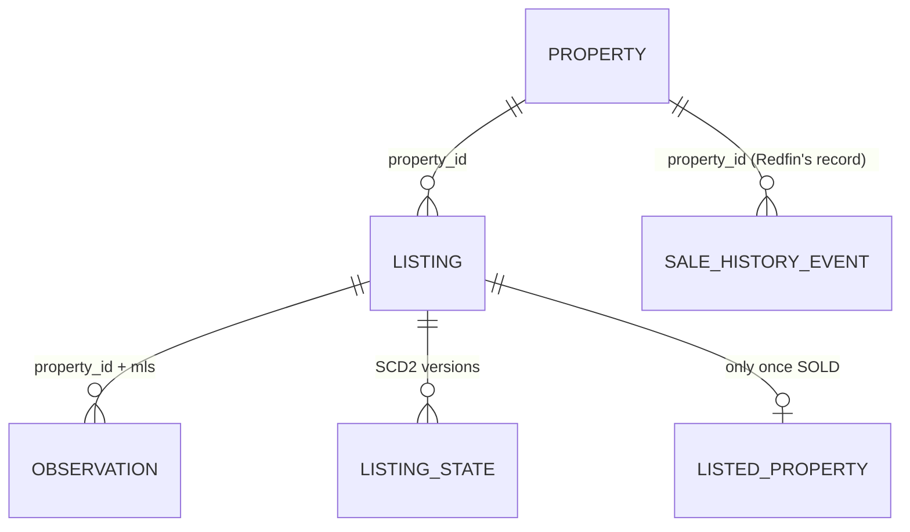
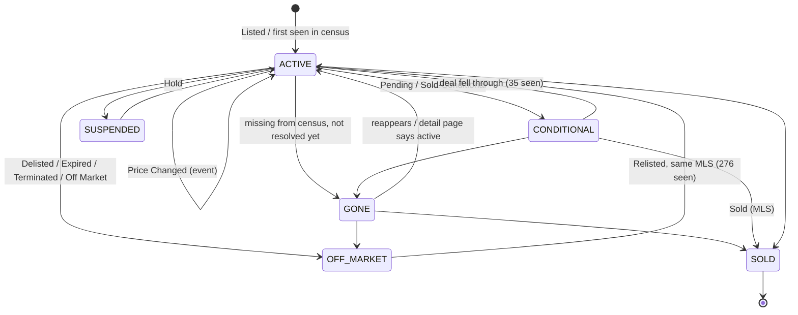

# Active listings: design

Status: **design only**, nothing here is implemented yet. Extends the pipeline in [ARCHITECTURE.md](ARCHITECTURE.md)
so it also follows listings that are still for sale: price changes, time on market, and how each listing ends.

Measured on the live container on 2026-10-18 (one-off read-only queries, not committed):
11,218 bronze pages over 8 fetch days, 7,577 silver listings / 7,576 properties, 27,735 sale-history events.

## 0. What the code does today, checked

| Claim | Verified? | Where |
|---|---|---|
| Daily Action runs discovery → extract → transform | Yes, as three workflow steps (not via `run_pipeline.py`, which is the local equivalent) | `.github/workflows/daily_scrape.yml` |
| Discovery pages `sold-3yr`, dedups against silver + `property_urls.txt`, stops after 3 empty pages | Yes. Dedup is by **property_id** | `get_properties.py:90`, `:174` |
| Extract writes `bronze/<day>/<name>.html.gz`, skips property ids in silver | Yes. Name = MLS or `P<property_id>`; one page per name per day (`put_bronze` refuses overwrite) | `scrape_properties_prod.py:47`, `azure_store.py:43` |
| Transform: newest bronze page per listing wins, monthly `listed_properties`, `--incremental`, `silver_v2` + `compare_silver.py` | Yes. `--incremental` skips any `(property_id, MLS)` already written, so **a row is never updated** once written | `transform_silver.py:130-136` |
| Sale history is a separate event table | Yes, and it is no longer a CSV: `silver/sale_history.parquet`, keyed by `property_id`, each event tagged with its `mls` | `parsing.history_rows`, `transform_silver.py:69` |
| Silver stores DOM / Sold Price Difference | Yes, now computed per sold MLS by `metrics.py` (`days_on_market`, `cumulative_dom`, `sold_vs_*_list`); legacy names kept for the map | `parsing.py:262` |
| `property_urls.txt` has non-Ottawa URLs | 17 of 687 lines are not `redfin.ca/on/`, but `parsing.in_scope()` already drops them in extract and transform. The oldest bronze page (`2026-02-19/UNKNOWN_…`) is an Idaho page that transform skips | `parsing.py:72` |

Things the prompt did not know, and that change the design:

1. **The map reads every `*listed_properties.parquet` under `silver/`** (`app/main.py:91`) and treats each row as a sale.
   Any active row written there becomes a fake sale on the map. Active data must live in **new tables**.
2. **Silver already contains unsold listings.** 113 properties' latest event is not a sale (64 Listed, 35 Delisted, 8 Relisted,
   3 Price Changed, 3 Pending). These are homes found through the sold search whose page now shows a newer listing. 20 rows have no
   `days_on_market` because their MLS never sold. Their `Sold Price` comes from the previous sale or the JSON-LD price, so the map is
   already showing some of them wrongly.
3. **Re-sales of a known home are never fetched.** Discovery and extract both dedup on `property_id`. A home sold in 2024 and
   sold again in 2026 keeps its 2024 row forever. 2,673 properties already have more than one MLS in their history, so this is common.
4. **Bronze already holds the raw JSON.** Each page embeds Redfin's own API responses (`"type":"application/json","status":200`,
   including `…/stingray/api/home/details/listingStatusBannerInfo/v1`), with `propertyId`, `listingId` (Redfin's internal listing
   id), `searchStatus` (4 on the sold page sampled; the value for active listings still needs confirming), `listingPrice`, `sashes` (`"Sold"`) and the full
   `propertyHistoryInfo`. Today's parser scrapes strings out of this; it does not need a separate JSON fetch.
5. **Relisting usually keeps the MLS number.** Of 368 `Relisted` events, 276 reuse the MLS of the previous `Listed`/`Delisted`.
   35 listings went `Pending` and then back to `Listed` on the same MLS (the deal fell through). So "same MLS" does **not** mean
   "same uninterrupted listing period", and "Sold → Active needs a new MLS" is the only safe version of that rule.
6. 25 silver rows have `longitude = NaN` (`extract_between(html, 'longitude":', "}")` misses a variant). They are not outside
   Ottawa; they cannot be placed at all.

## 1. Entity model



| Entity | Key | Meaning | Today |
|---|---|---|---|
| property | `property_id` | the physical home (`/home/<id>`) | implicit |
| listing | `(property_id, mls)` | one MLS listing of that home. Redfin's `listingId` is stored as an attribute, not a key: it is internal and has no outside meaning | `listed_properties` key |
| observation | `(property_id, mls, observed_on, origin)` | what *we* saw on one day, from the census (`origin='census'`) or a detail page (`origin='detail'`) | does not exist |

How today's silver fits in: `listed_properties` is "one row per listing, newest page wins". That is correct **only for listings in a
terminal state**: once sold, a listing never changes, so its last page is its whole truth. The new rule is
**`listed_properties` holds sold listings only**, and the timeline of every listing (sold or not) lives in observations,
events and state.

Definitions (as of a date `t`; for a sold listing `t` = sold date, which reproduces `metrics.py` exactly):

* **DOM (current listing)**: `t − first Listed date of this MLS`. A same-MLS `Delisted`/`Relisted` gap is **counted**: the MLS
  number stayed the same, and the boards count it the same way. If Redfin's history has no `Listed` event for the MLS, use the first
  census observation and set `dom_basis='observed'`.
* **Cumulative DOM**: `metrics._cumulative_dom` unchanged, with `sold_date` replaced by `t`: this listing plus earlier unsold listings
  of the same home, back to the previous sale. Implementation: give `listing_metrics` an `as_of` parameter so active and sold share one
  function and one test file.

## 2. State machine

`Price Change` is an **event**, not a state: the listing stays `ACTIVE` with a new asking price. States are per listing (`mls`):



Mapping from Redfin's `status` / `event_type` (values seen in `sale_history.parquet`):
`Active→ACTIVE`, `Pending|Sold-Conditional*→CONDITIONAL`, `Hold→SUSPENDED`,
`Off Market|Expired|Terminated|Delisted→OFF_MARKET`, `Closed|Sold|Sold (MLS)→SOLD`.

* **SOLD is the only terminal state.** `OFF_MARKET` is not terminal: three quarters of relists come back on the same MLS. After
  `OFF_MARKET_FINAL_DAYS` (start with 180) without a relist, the listing is treated as **ended unsold** for statistics, while the
  state row stays open.
* **GONE = right-censored.** A listing that drops out of the census is not assumed sold. It stays `GONE` (censored at its last
  census date) until a detail fetch resolves it. In survival statistics it counts as "on market at least until last_seen".
* **Hand-off to the sold path (no duplicate):** `ACTIVE → GONE` puts the listing first in the fetch plan. The detail fetch writes
  `bronze/<day>/<MLS>.html.gz` exactly as today. Transform sees a `Sold` event for that MLS, so it writes the
  `listed_properties` row through the **existing, unchanged** code and closes the listing's state at `SOLD`. Key `(property_id, MLS)`
  is the same throughout. Because `listed_properties` only ever gets terminal rows, `--incremental`'s "skip if already written" stays
  correct. If the sold search finds the same listing first, the result is identical: the same page, the same key, and one row.

## 3. Bronze

Keep the existing layout untouched and add a sibling prefix:

```
bronze/<day>/<MLS|P<pid>>.html.gz                 (unchanged) detail pages: sold and now active
bronze/search/<day>/<slice>.json.gz               NEW census: raw search API responses, one per slice
bronze/search/<day>/<slice>.html.gz               NEW fallback if the JSON can't be captured
```

* `azure_store.list_bronze()` only accepts 3-part names, so the new 4-part `bronze/search/…` paths are **invisible to today's
  transform**. Nothing existing breaks.
* **How to get JSON without extra requests:** the census is the same Playwright page load discovery already does. Register
  `page.on("response")` and save any response whose URL contains `/stingray/api/gis` (the search results endpoint on redfin.com).
  **To verify on redfin.ca before building**: one headed Playwright run with that listener, logging response URLs. If redfin.ca
  serves results only inside the HTML, store the HTML and parse the embedded `reactServerState` the same way detail pages are.
  Do **not** call the API URLs directly: it is a different request pattern from a browser and the most likely thing to get the WAF
  to block you.
* Detail pages already contain their API responses, so there is nothing to add. The parser can move gradually from string slicing to
  reading that JSON, and replay from bronze picks the change up for free.
* Append-only, as now: `overwrite=False`, plus `fetched_at` and `url` metadata. Census blobs also carry `slice` and `total_reported`
  (the result count Redfin shows) in metadata, which feeds a validation check.
* **Slicing:** Redfin search results are capped per query (historically about 350 homes; check the header count). Ottawa's active
  inventory is several thousand, so the census is split into price bands (`min-price=…,max-price=…`), each kept under the cap.
  The slice list lives in code; if any slice comes back at the cap, the run logs it and the band is split.

## 4. Silver

| Table | Path | Grain / key | Written |
|---|---|---|---|
| `listed_properties` (unchanged) | `silver/<YYYY-MM>/listed_properties.parquet` | `(property_id, MLS)`, **sold only** | as today |
| `sale_history` (unchanged) | `silver/sale_history.parquet` | `(property_id, event_date, event_type, source_id, price)` | as today |
| `observations` NEW | `silver/observations/<YYYY-MM-DD>.parquet` | `(property_id, mls, observed_on, origin)` | 1:1 parse of that day's census + detail pages |
| `listing_events` NEW | `silver/listing_events.parquet` | `(property_id, mls, event_date, event_type, price, origin)` | rebuilt each run |
| `listing_state` NEW | `silver/listing_state.parquet` | `(property_id, mls, valid_from)` | rebuilt each run (SCD2) |

The new tables don't end in `listed_properties.parquet`, so `list_silver()` and `app/main.py` ignore them automatically.

**observations**: `property_id, mls, listing_id, observed_on (date), observed_at (ts, from blob metadata), origin ('census'|'detail'),
slice, status_raw, state, list_price, beds, baths, sqft, latitude, longitude, property_type, url, row_hash`.
`row_hash = sha1(status_raw, list_price, beds, baths, sqft, property_type)`. It deliberately **excludes** DOM / "time on Redfin",
which change every day and would make every listing look changed.

**listing_events**: the union of
(a) `sale_history` rows that have an `mls` (`origin='redfin'`), and
(b) changes derived from consecutive observations (`origin='observed'`: `first_seen`, `price_change`, `state_change`, `gone`, `reappeared`).
Dedup rule: an observed `price_change` to price P on an MLS **matches** a recorded `Listed`/`Price Changed` at price P whose
`event_date` is within ±3 days. The matched pair is linked (`matched_event_key`), not merged, because the disagreement between the two is
what validation (b) measures. Gold uses the recorded date when there is a match and the observed date otherwise.

**listing_state** (SCD2): `property_id, mls, state, list_price, valid_from, valid_to (NULL = current), is_current, opened_by
(event key), closed_by`. It is built by folding `listing_events` in `(event_date, origin priority, event_seq)` order. It is
deterministic and does not depend on when the job ran, which is what makes replay possible.

**Partitioning.** Monthly-by-bronze-month still works for `listed_properties`, because a sold row is written once. It does **not**
work for timelines: a listing that spans March to June would be split across four files. So:
`observations` is partitioned **by observation day** (append a new day, never rewrite old ones; ≈ 4k rows/day ≈ 1.5M rows/year).
`listing_events` and `listing_state` are **single files** (≈ 10–20k listings × a few versions each, a few MB) rewritten each run,
the same way `sale_history.parquet` is today.

## 5. Gold

Nothing is built yet (`gold/` is empty per ARCHITECTURE.md). Proposed tables, all rebuilt from silver each run:

| Table | Grain | Contents |
|---|---|---|
| `gold/active_listings.parquet` | current open listing (`is_current` and state ∈ ACTIVE, CONDITIONAL, SUSPENDED) | list price, original price, number of price cuts, % cut, DOM and cumulative DOM **as of the build date**, last_seen |
| `gold/price_changes.parquet` | one price change | old → new price, Δ%, days since listed, origin |
| `gold/time_on_market.parquet` | (listing-month cohort × property-type group × day) | Kaplan–Meier survival: event = SOLD, censored = still open / GONE / ended unsold. Also median days to sale with a CI |
| `gold/market_monthly.parquet` | month × type group | active count (snapshot on the 15th and month-end), new listings, sales, median sale-to-list (`sold / last ask`), median DOM, months of inventory |

Kaplan–Meier uses `lifelines` (pure Python, one dependency). Withdrawn listings are a competing outcome, not plain censoring. KM that
censors them slightly overstates the chance of selling; if that matters later, swap in Aalen–Johansen (also in `lifelines`).

**Stored vs computed:**
* For **sold** listings keep `days_on_market`, `cumulative_dom`, `sold_vs_last_list`, `sold_vs_original_list` stored in
  `listed_properties`. They are computed from terminal, immutable data, so they cannot go stale, and the map needs them.
  `Days On Market` / `Sold Price Difference` stay until `app/main.py` reads the new names (already planned in ARCHITECTURE.md),
  then they are dropped.
* For **active** listings, nothing time-dependent is stored in silver: DOM, % cut and similar values are computed in gold for the
  build date.

## 6. Extract / refresh strategy

`known_property_ids()` → **`fetch_plan()`**: the "state queue" that `scrape_properties_prod.py`'s docstring already promises.
It is computed from `listing_state` + the latest census and nothing else:

| Priority | Who | Why |
|---|---|---|
| 0 | the census itself (search slices) | cheapest (≈ 40 listings per page load) and drives everything else |
| 1 | listings that became `GONE` today | resolves sold vs. off-market; without it the sold hand-off stalls |
| 2 | listings first seen today | get Redfin's history, photo and attributes |
| 3 | open listings whose `row_hash` changed to a new **state** | confirm the state with the recorded event |
| 4 | open listings not fetched in `STALE_DAYS` (start at 30) | catches changes the census doesn't show |
| 5 | sold backfill from `property_urls.txt` (today's queue) | historical and not time-sensitive |

Price-only changes need **no** detail fetch: the census already records the new price. The detail page is only fetched for them
under priority 4.

Skip rule: a `(property_id, mls)` is skipped when `listing_state` has it `SOLD`, **not** when the property id is known. This also
fixes finding 3 (re-sales of known homes), because a new MLS on a known property is a new key.

**Daily volume (estimate; replace with the first week's real numbers):** Ottawa (OREB area) has roughly 3–5k active listings,
≈ 1.5–2k new listings and a similar number of exits per month.

| Work | Requests/day |
|---|---|
| census, ≈ 4k / 40 per page | ≈ 100 search page loads |
| priority 1 (exits) | ≈ 60 |
| priority 2 (new) | ≈ 60 |
| priority 3 (state changes) | ≈ 20 |
| priority 4 (stale, 4k / 30) | ≈ 130 |
| **total** | **≈ 100 search + ≈ 270 detail** |

Today's run caps detail at `MAX_SCRAPE_COUNT=300`, and bronze shows single days of 4–5k pages when cookies were fresh, so this fits.
The risk is the census: 100 search pages in a row is more than discovery usually does. Spread slices with jitter, and keep
discovery's "3 empty pages → stop" rule per run.

**When blocked partway:** work strictly by priority, and **commit what you have**. A partial census is still saved (slice by slice,
each its own blob) and marked with `complete=false` metadata. Transform does **not** mark listings `GONE` from an incomplete census:
absence only counts when every slice of that day succeeded. Otherwise one blocked run would "end" thousands of listings. Today's
"transform runs even if extract failed" (`if: always()`) stays.

## 7. Discovery

* `get_properties.py` gets `--mode sold|census`. `sold` is today's behaviour. `census` walks the price-band slices of the
  for-sale search and writes `bronze/search/…` instead of URLs. The pagination and blocked-page code is shared.
* **Separate queues.** The census needs no URL file: the census is the queue, and `fetch_plan()` reads it from silver.
  `property_urls.txt` stays the sold-backfill queue only. Keep it out of the census path so a 4k-line daily list doesn't churn git
  history the way the "Add N newly discovered listing URLs" commits do.
* **Ottawa filter:** `parsing.in_scope()` (Ontario, redfin.ca) stays as the URL gate. Add `parsing.in_ottawa(lat, lon)` applied in
  transform: a bounding box (lat 44.96–45.54, lon −76.36–−75.24) now, and the City of Ottawa boundary GeoJSON (Open Ottawa) +
  `shapely` if edge towns matter. Rows outside go to a `rejected` count in the run log, not into silver. Fix the `longitude` parser
  gap (finding 6) at the same time, otherwise those 25 rows fail the filter for the wrong reason.

## 8. Tooling

**Recommendation: keep pandas + Parquet on Azure Blob for silver, use DuckDB for gold and validation, skip dbt.**

* The data is small (MBs per day). Every stage already reads and writes whole Parquet files through `azure_store`, and tests are plain
  pytest on pure functions (`tests/test_metrics.py`). The SCD2 fold is about 40 lines of pandas over a sorted event list, and fits
  that pattern.
* DuckDB is already a dependency (`app/main.py` uses it). Gold tables and validation checks read more clearly as SQL over
  `read_parquet('…/observations/*.parquet')` than as pandas.
* **Why not dbt snapshots:** a dbt snapshot records *when dbt ran*, not when the data was observed. Rebuilding from bronze would
  collapse all history into one snapshot, which breaks the "bronze is the source of truth, silver can always be rebuilt" rule.
  dbt-duckdb also adds a profile and project layout for a single-person pipeline with one daily job. Reconsider dbt only if gold
  grows into many interdependent models.

## 9. Migration and backfill

All of it uses the existing **write to `silver_v2/`, compare, then switch** pattern, so live `silver/` and the map are never
touched until the comparison is clean.

1. **Seed `listing_events`** from `silver_v2/sale_history.parquet` (`origin='redfin'`). This already covers 14 years of events
   for 7.5k properties. **Seed `listing_state`** by folding those events. Listings whose last event isn't a sale (finding 2) become the
   first open listings and go into the first `fetch_plan()`.
2. **Remove unsold rows from `listed_properties`**: in transform, only write a row when that MLS has a `Sold` event. Run into
   `silver_v2`, then `compare_silver.py` should show exactly the ≈ 113 dropped keys and nothing else. Then switch.
3. **Observations backfill:** none is possible for the past (no census was ever saved), and that is fine: censoring handles it. The
   timeline before the first census day comes only from Redfin's recorded history.
4. `compare_silver.py` gains `--table observations|listing_events|listing_state`: a row-for-row diff on each table's key, sorted.
5. `daily_scrape.yml` order: census → extract (`fetch_plan`) → sold discovery → transform → gold → validate. Validation failures fail
   the job (red X) but run after the data is written, so a bad check never blocks the map.

## 10. Validation that doesn't depend on our judgment

Implemented as `validate.py` (DuckDB SQL), run at the end of every workflow run, results appended to `gold/validation_log.parquet`.

**(a) Against OREB / CREA monthly statistics** (entered by hand monthly into `app/Redfin/reference/oreb_monthly.csv`: month,
property class, new listings, units sold, active inventory, DOM; source URL per row).

| Metric | Our side | Tolerance |
|---|---|---|
| units sold / month | `listed_properties` by sold month | ±10% |
| new listings / month | `listing_events` first `Listed` per MLS | ±15% |
| active inventory (month-end) | census distinct open listings | ±15% |
| DOM | median, or mean if that is what OREB publishes (match their definition, likely cumulative) | ±5 days |

OREB's area and property classes differ from a Redfin Ottawa search, so treat the first two months as calibration: record the
offset, then freeze the tolerances. The **units sold** check can run **today**, before any active work, and is a coverage test
of the existing sold pipeline.

**(b) Two independent paths agree.** For every listing observed in the census and later `SOLD`: each observed asking price
must appear in the recorded `Listed`/`Price Changed` prices of that MLS on its sold page, dated within ±3 days. Pass: ≥ 98% of
observed changes matched. The reverse direction (recorded changes we never observed while the listing was open) measures census
coverage.

**(c) Replay.** Monthly: rebuild `silver_v2/` and `gold_v2/` from bronze from scratch, then `compare_silver.py --table …` for every
table. Pass: 0 differing rows after sorting by key. Byte-for-byte equality is not the test (Parquet metadata and row-group
layout vary). Requirement this puts on the code: transform never uses `now()`, only `observed_on` from the bronze path/metadata.

**(d) Rules the data must always satisfy** (each a SQL query that must return 0 rows):
* no event on an MLS dated after that MLS's `Sold` event (the correct form of "no Sold → Active without a new MLS"; same-MLS
  Delisted → Relisted and Pending → Listed are legitimate, see finding 5);
* `listing_state`: `valid_to > valid_from`, no overlapping intervals per listing, exactly one `is_current` row per listing, nothing
  open after `SOLD`;
* every `listed_properties` row has a `Sold` event for its MLS (catches finding 2 coming back);
* every silver row passes `in_scope(url)` and `in_ottawa(lat, lon)`, and longitude/latitude are not null (catches finding 6);
* a day's census slices sum to within 2% of the `total_reported` header, and no slice is at the cap;
* `GONE` is only ever set from a complete census day.

## 11. Constraints

* **Redfin's Terms of Use** prohibit automated access and scraping. The listing content is board/CREA MLS® data under the boards'
  licence terms. This is a personal, non-commercial project. Keep request volume low (section 6), and do not redistribute raw listing
  data.
* **The container is publicly readable.** `app/main.py` builds image links as
  `https://stredfinprod.blob.core.windows.net/redfin-data/<blob>`, which only works if the container allows public blob reads. Bronze (raw pages,
  and soon daily snapshots of the whole market) sits in the same container, so anyone who guesses a blob name can download it.
  Move `bronze/` and `silver/` to a private container and leave only `images/` public, before the census starts adding a full
  daily copy of the market.
* Censored data is not sold data: anything shown publicly (the map) should label active and GONE listings as such.

## First slice (one weekend)

1. `get_properties.py --mode census`: price-band slices, save raw responses to `bronze/search/<day>/`, with `complete` and
   `total_reported` metadata. (Do the one-off `page.on("response")` check first.)
2. `transform_observations.py`: census → `silver/observations/<day>.parquet` + `in_ottawa` filter.
3. A DuckDB query: open listings today, `first_seen`, `gone` since yesterday.

**Check that proves it works:** after 7 daily runs, (i) census slice totals are within 2% of `total_reported` every day, (ii) the
open-listing count is within the calibration band of OREB's latest active inventory, and (iii) every listing marked gone appears in
the next day's `fetch_plan()` at priority 1. The state machine, gold and the hand-off build on top of these observations.
