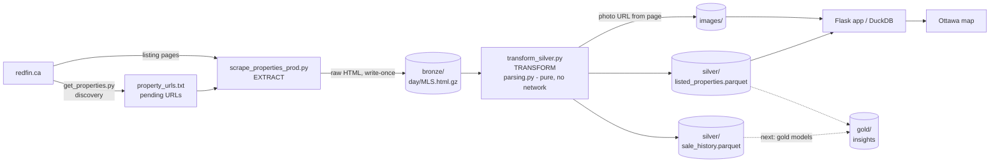
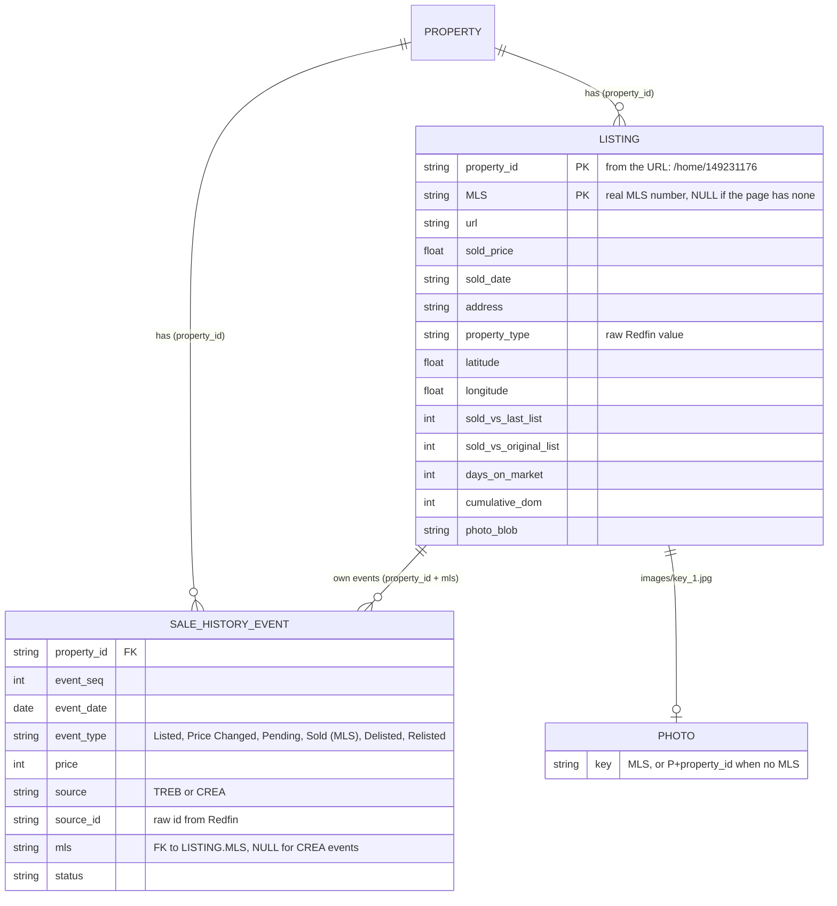

# Redfin pipeline architecture

## Data flow

Bronze is the source of truth. Silver and gold can always be rebuilt from it without contacting redfin.ca.

## Tables and keys

* A **property** is a physical home (`property_id`). It can have several **listings** over the years, each with its
  own MLS number. One Redfin page shows the events of *all* of them, which is why sale history is keyed by
  `property_id` and carries an `mls` per event.
* Join events to the listing they belong to with `property_id` **and** `mls`. Join on `property_id` alone to get
  the whole life of the home.
* Event identity: `(property_id, event_date, event_type, source_id, price)`.

## Sale metrics (metrics.py)

Computed per listing from the sold listing's **own** events (matched by MLS), never from earlier listings of the
same home. Unit-tested in `tests/test_metrics.py`.

| Column | Definition |
|---|---|
| `sold_vs_last_list` | sold price - last Listed / Price Changed price of that MLS on or before the sale (sale-to-list) |
| `sold_vs_original_list` | sold price - first Listed price of that MLS |
| `days_on_market` | sold date - first Listed date of that MLS |
| `cumulative_dom` | days on market plus the earlier unsold listings of the same home, back to the previous sale (a relist does not reset it) |

The map's legacy columns `Days On Market` and `Sold Price Difference` hold `days_on_market` and `sold_vs_last_list`
until the app reads the new names. Listings whose sold event has no MLS (e.g. Sold (Public Records) only) have no metrics.

## Layers

| Layer | Location | Written by | Mutable? |
|---|---|---|---|
| bronze | `bronze/<day>/<MLS or P+property_id>.html.gz` | extract | never (write-once) |
| silver | `silver/<YYYY-MM>/listed_properties.parquet`, `silver/sale_history.parquet` | transform | rebuilt from bronze |
| images | `images/<key>_1.jpg` / `_sv.jpg` | transform | idempotent |
| gold | not built yet | | |
