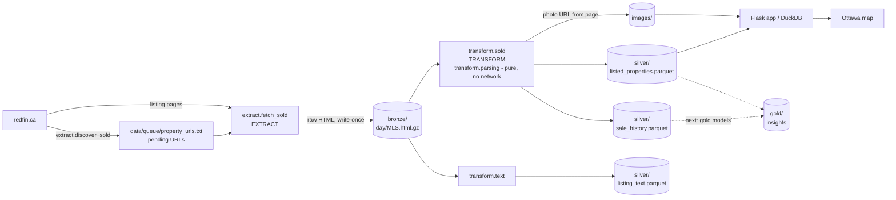
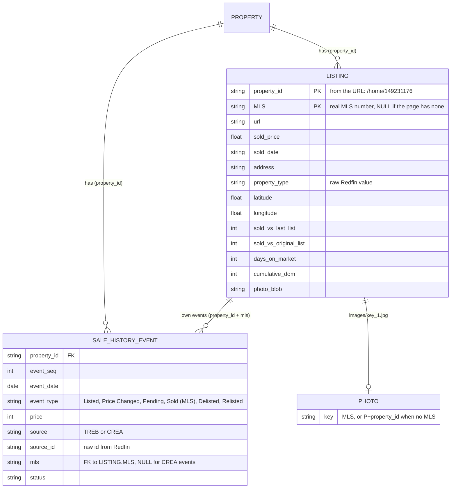

# Redfin pipeline architecture

Module names are relative to the `redfin` package (`redfin/src/redfin/`). Commands: [../CLAUDE.md](../CLAUDE.md). Current state: [STATUS.md](STATUS.md).

## Data flow



Bronze is the source of truth. Silver and gold can always be rebuilt from it without contacting redfin.ca.

## Tables and keys



* A **property** is a physical home (`property_id`). It can have several **listings** over the years, each with its
  own MLS number. One Redfin page shows the events of *all* of them, which is why sale history is keyed by
  `property_id` and carries an `mls` per event.
* Join events to the listing they belong to with `property_id` **and** `mls`. Join on `property_id` alone to get
  the whole life of the home.
* Event identity: `(property_id, event_date, event_type, source_id, price)`.

## Sale metrics (transform/metrics.py)

Computed per listing from the sold listing's **own** events (matched by MLS), never from earlier listings of the
same home. Unit-tested in `redfin/tests/test_metrics.py`.

| Column | Definition |
|---|---|
| `sold_vs_last_list` | sold price - last Listed / Price Changed price of that MLS on or before the sale (sale-to-list) |
| `sold_vs_original_list` | sold price - first Listed price of that MLS |
| `days_on_market` | sold date - first Listed date of that MLS |
| `cumulative_dom` | days on market plus the earlier unsold listings of the same home, back to the previous sale (a relist does not reset it) |

The map's legacy columns `Days On Market` and `Sold Price Difference` hold `days_on_market` and `sold_vs_last_list`
until the app reads the new names. Listings whose sold event has no MLS (e.g. Sold (Public Records) only) have no metrics.

## Layers

| Layer | Location | Written by | Mutable? |
|---|---|---|---|
| bronze | `bronze/<day>/<MLS or P+property_id>.html.gz` | extract | never (write-once) |
| silver | `silver/<YYYY-MM>/listed_properties.parquet`, `silver/sale_history.parquet`, `silver/listing_text.parquet` | transform | rebuilt from bronze |
| silver_v2 | same layout as silver | full rebuilds, for comparison (DECISIONS D3) | scratch |
| images | `images/<key>_1.jpg` / `_sv.jpg` | transform | idempotent |
| gold | not built yet | | |

Also in the container: `silver_backup/<timestamp>/`, manual copies of silver made before full rewrites (read by nothing).

## Active listings (listings still for sale)

Sold listings are final, so one fetch is the whole truth. Active ones change, so they get their own prefixes and are
never mixed into the sold path: the sold transform reads every `bronze/<day>/*.html.gz`, and an active page parsed
there would become a fake sale. Design and planned tables: [ACTIVE_LISTINGS.md](ACTIVE_LISTINGS.md).

```
extract.census     for-sale search, sliced by price (a page embeds at most 350 homes)  -> bronze/search/<day>/*.json.gz + manifest.json
extract.fetch_active detail pages of census listings: never fetched first, then stalest (price history) -> bronze/active/<day>/<MLS>.html.gz
transform.active   census row (identity, price, coordinates) + the NEWEST page of that MLS over all days
                   (events: metrics.active_metrics), minus homes already sold (matched on MLS)
                                                                                       -> silver/active/listings.parquet
                                                                                       -> silver/active/reconciled_out.parquet (mls, sold_date, reason)
app/main.py        /ottawa_active page, POST /active-points (circle + filters + insights)
```

* The census row is the identity of a listing (MLS, listingId, price, status); the detail page is only used for its events.
  A page can name several MLS numbers (relists), so `extract.fetch_active` checks the page contains the census row's `listingId`.
* Active listings are keyed by MLS. Redfin sometimes holds one MLS listing under two propertyIds; `census.read_census` keeps
  the lowest and records the others in `alt_property_ids`.
* Days on market and price changes are computed from the events as of the census day (never the clock), with the same
  definitions as the sold metrics. Redfin's own `dom` restarts on a relist, so it is kept only as `dom_redfin`.
* `silver/active/listings.parquet` is a snapshot as of the census day (`as_of`), rebuilt from bronze: one row per census MLS that
  has a detail page, built from that MLS's newest page (`page_day`). Neither it nor `reconciled_out.parquet` ends in
  `listed_properties.parquet`, so the sold map never loads them. Reconcile rule (D13): matched on MLS only; a silver row is a
  sale only with a Sold/Closed event for its MLS in `sale_history`, or a sale metric on the row; `Sold Date` alone is not proof.
* `python -m redfin.daily` runs the whole chain; see [../CLAUDE.md](../CLAUDE.md), Commands.
